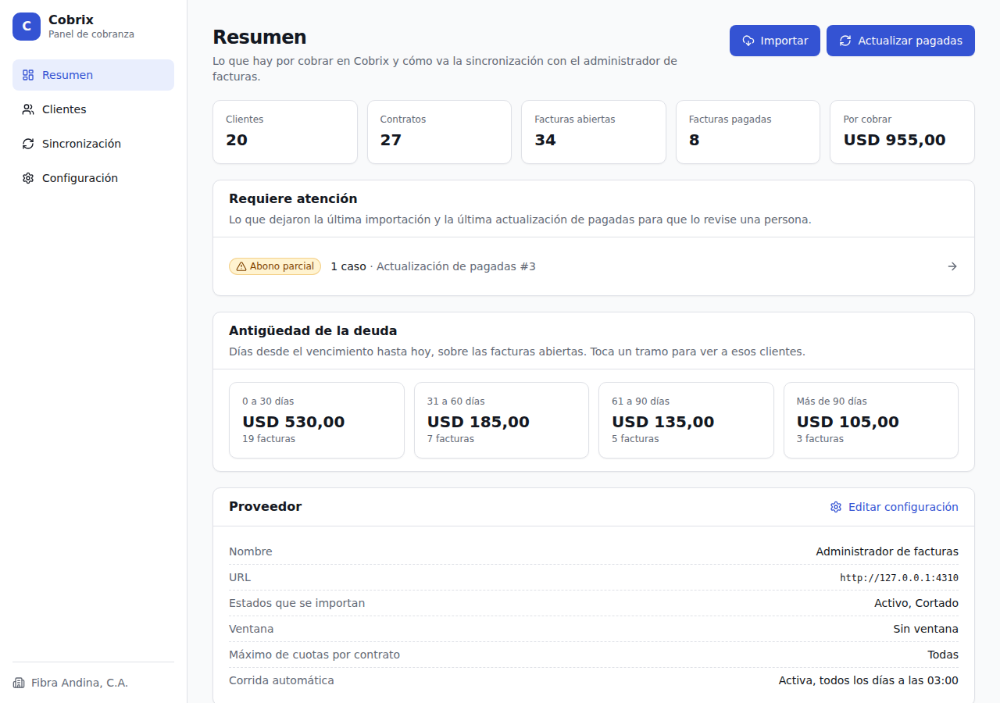
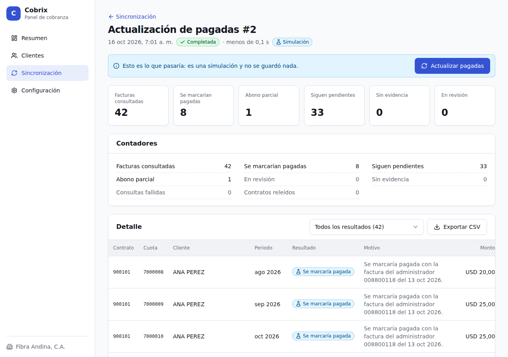
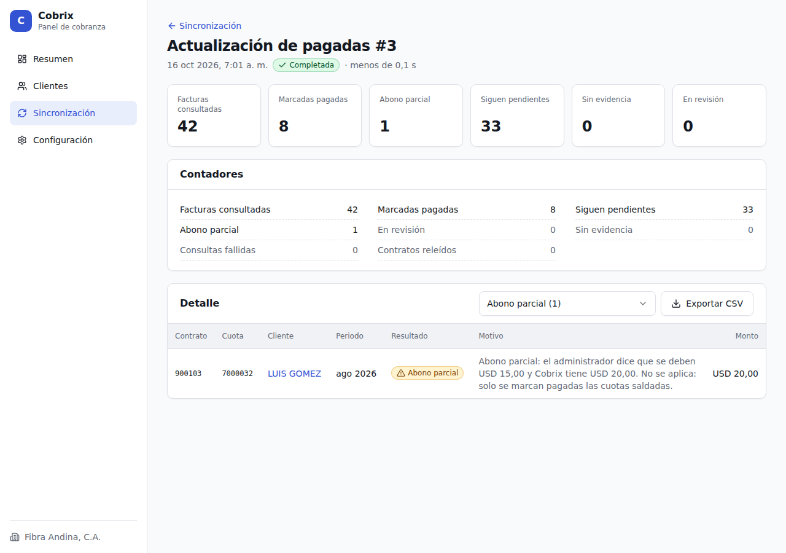
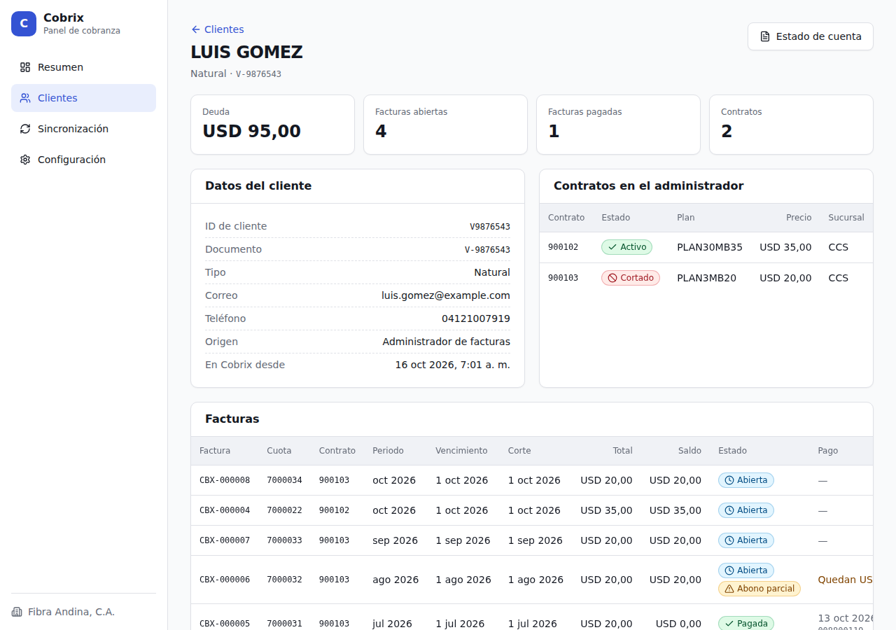
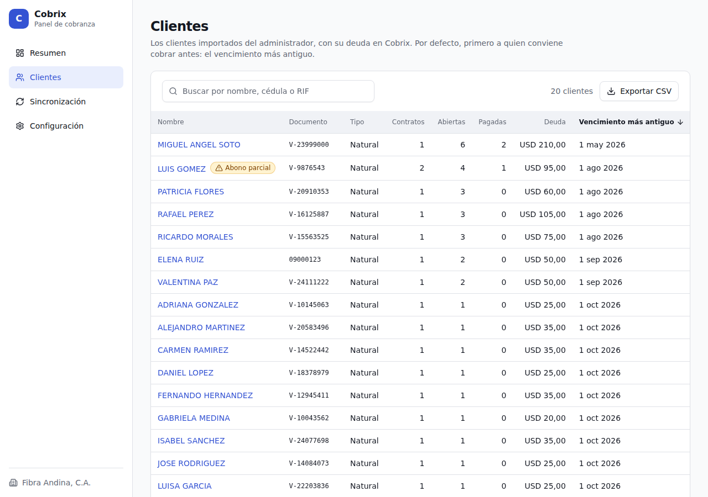
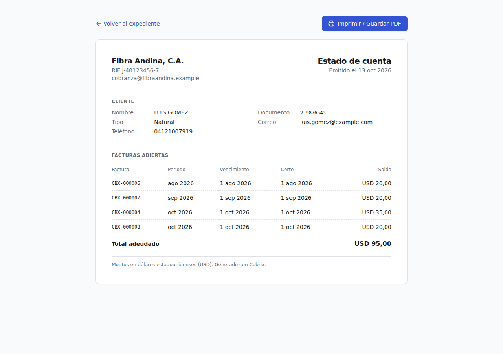
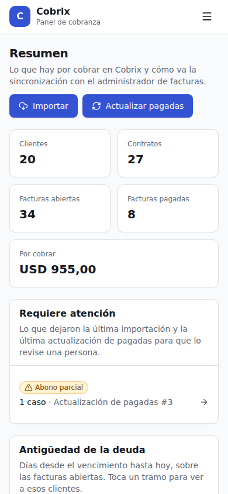
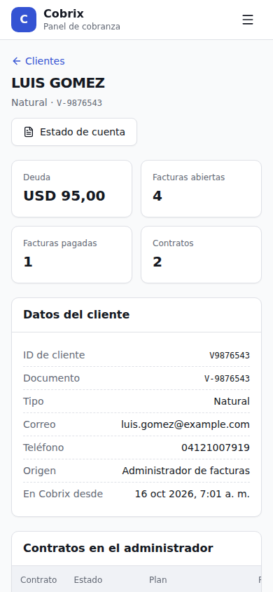

# Cobrix · integración con el administrador de facturas

Importa clientes y facturas desde la API del **administrador de facturas** de un ISP, aplica los pagos que el ISP ya cobró y ofrece un panel para operarlo. Suma la antigüedad de la deuda, la exportación a CSV, el estado de cuenta imprimible, un registro de auditoría y «Requiere atención».

## Levantar

Requiere **Node 24**.

```bash
npm install
npm start
```

Compila el panel y levanta todo en un proceso. Abre **http://127.0.0.1:4300**.

| Parte | Qué es | Dónde |
| --- | --- | --- |
| **Administrador de facturas** | La API simulada del ISP que vino con la prueba (`src/billing-api/`, no se toca) | http://127.0.0.1:4310/api/v1 · Swagger en `/docs` |
| **Cobrix** | La API JSON en **NestJS** (`src/server/`) sobre las reglas (`src/cobrix/`) | http://127.0.0.1:4300/api |
| **Panel** | La app **React** (`src/panel/`), que Cobrix sirve compilada | http://127.0.0.1:4300 |

Por separado: `npm run start:isp` (administrador), `npm run start:cobrix` (Cobrix y el panel) y, opcional, `npm run dev` (panel con recarga en http://127.0.0.1:5173).

## Datos para probar

Son **solo para la prueba**: las credenciales son las públicas del administrador simulado ([`docs/API.md`](docs/API.md)) y la empresa es inventada.

| Bloque de Configuración | Campo | Valor |
| --- | --- | --- |
| **Administrador de facturas** | URL de la API | `http://127.0.0.1:4310` |
| | Usuario | `cobrix` |
| | Contraseña | `cobrix-sandbox` |
| **Empresa** (membrete del estado de cuenta) | Nombre | `Fibra Andina, C.A.` |
| | RIF | `J-40123456-7` |
| | Correo de cobranza | `cobranza@fibraandina.com` |

El botón «Usar el sandbox de la prueba» completa las credenciales. Sin los datos de la Empresa, el estado de cuenta no se genera.

## Recorrido de 5 minutos

1. **Configuración** → carga los [datos de prueba](#datos-para-probar): «Probar conexión» (27 contratos), «Guardar proveedor» y «Guardar empresa».
2. **Sincronización** → «Simular importación» y, desde ese detalle, «Importar»: 20 clientes y 42 facturas por USD 1.235,00.
3. **Pagos del ISP** en el Swagger, sección «Simulador», con `POST /__sim/pagar`:

   | Cuerpo | Qué es |
   | --- | --- |
   | `{"id_contrato": 900101}` | ANA PEREZ paga todo |
   | `{"id_contrato": 900103, "monto": 25}` | LUIS GOMEZ paga julio y abona 5 de agosto |
   | `{"id_contrato": 900104}` | COMERCIAL EL FARO paga todo |
   | `{"id_contrato": 900114, "monto": 70}` | MIGUEL ANGEL SOTO paga sus 2 cuotas más viejas |
   | `{"id_contrato": 900113}` | ELENA RUIZ paga; después se anula con `POST /__sim/anular` y el `id_factura` devuelto |

4. **Sincronización** → «Actualizar pagadas»: 8 pagadas; el abono de LUIS y ELENA, sin cambios.
5. **Resumen** → 34 abiertas por USD 955,00. «Requiere atención» lleva al abono de LUIS. Prueba «Más de 90 días», el expediente y el «Estado de cuenta» de LUIS y «Exportar CSV» en Clientes.

## Capturas

| | |
| --- | --- |
|  **Resumen** |  **Simulación, lista para aplicar** |
|  **Detalle de corrida** |  **Expediente** |
|  **Clientes** |  **Estado de cuenta** |

<p>
  
  
</p>

## Pruebas

```bash
npm test            # 208 pruebas: reglas, ciclo completo contra la API simulada, API, punto diferencial y seguridad
npm run typecheck   # backend y panel
npm run build       # compila el panel
```

Las que necesitan al administrador lo levantan en una carpeta temporal: no tocan `data/`. Lo que se revisa a mano está en [`specs/verificacion.md`](specs/verificacion.md).

## Datos y variables

- `npm start` fija la fecha de trabajo en **2026-10-13** (`SANDBOX_TODAY`), la de los criterios.
- Los pagos del Swagger quedan en `data/billing-api.sqlite`. Para volver al estado entregado, con el servidor apagado: `git checkout data/billing-api.sqlite`. No uses `npm run seed` para eso: regenera las cuotas según la fecha del día y los números del recorrido cambian.
- Para empezar de cero en Cobrix, con el servidor apagado, borra `data/cobrix.sqlite*`.
- Si el 4300 o el 4310 ya están ocupados (por ejemplo, por otro `npm start`), el arranque falla con `EADDRINUSE`: apaga el otro proceso o usa `PORT` y `BILLING_API_PORT`. Si cambias el puerto del administrador, usa esa URL en Configuración.

| Variable | Por defecto | Qué es |
| --- | --- | --- |
| `PORT`, `BILLING_API_PORT`, `HOST` | `4300`, `4310`, `127.0.0.1` | Dónde escuchan Cobrix y el administrador |
| `COBRIX_DB`, `BILLING_API_DB` | `data/cobrix.sqlite`, `data/billing-api.sqlite` | Las dos bases |
| `COBRIX_AUDIT_DIR` | `logs/` | Registro de auditoría |
| `COBRIX_SECRET_KEY` | Un `.key` junto a la base, creado solo | Clave que cifra la contraseña del proveedor |
| `SANDBOX_TODAY` | `2026-10-13` | Fecha de trabajo |

## Auditoría, CSV y estado de cuenta

- **Auditoría:** cada acción (guardar la configuración, probar la conexión, cada corrida, cada exportación y cada estado de cuenta) agrega una línea JSON a `logs/cobrix-AAAA-MM-DD.log`, un archivo por día de Caracas: `{"at", "actor": "operador" | "sistema", "action", …}`. Nunca lleva contraseñas ni tokens. La carpeta se cambia con `COBRIX_AUDIT_DIR` y crece sin límite: rotarla es tarea del servidor (por ejemplo, con `logrotate`).
- **CSV:** «Exportar CSV» en Clientes y en el detalle de una corrida descarga lo que muestra la tabla, con su filtro. Está hecho para Excel en español (separador `;`, montos `95,00`, UTF-8 con BOM): se abre con doble clic, sin importar.
- **Estado de cuenta:** en el expediente, «Estado de cuenta» abre una hoja A4 con el membrete de la empresa. El PDF se saca con «Imprimir» del navegador. Sin deuda, sale como constancia.

## Documentación

- [`NOTA.md`](NOTA.md): decisiones, lo que quedó fuera y el punto diferencial.
- [`ARQUITECTURA.md`](ARQUITECTURA.md): cómo está armado.
- [`USO-DE-IA.md`](USO-DE-IA.md): qué hice yo y qué hizo la IA.
- [`specs/`](specs/): constitution, spec, plan, modelo de datos y tareas. [`src/cobrix/README.md`](src/cobrix/README.md): mapa del código.
- [`docs/ENUNCIADO.md`](docs/ENUNCIADO.md): el enunciado.
