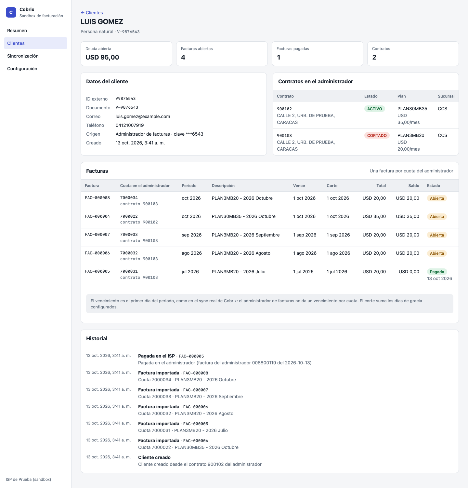

# Prueba técnica: integración con un administrador de facturas

## 1. Contexto

Cobrix cobra por cuenta de proveedores de internet (ISP). Cada ISP lleva a sus clientes en su propio **administrador de facturas**: contratos, cuotas mensuales y cobros. Para cobrarlas, Cobrix necesita traer esos datos y mantenerlos al día.

Tu tarea es construir esa integración: **importar clientes y facturas** desde la API del administrador y **aplicar los pagos** que el ISP ya cobró, con un panel para operarlo.

Tiempo estimado: **4 días**.

## 2. Qué te entregamos

| Pieza | Dónde |
| --- | --- |
| API del administrador de facturas, simulada sobre SQLite | `src/billing-api/`, base en `data/billing-api.sqlite` |
| Documentación de la API (Swagger) | http://127.0.0.1:4310/docs y [`API.md`](API.md) |
| Simulador de la caja del ISP, para crear pagos y anulaciones | Sección «Simulador» del Swagger (rutas `/__sim/*`) |
| Esqueleto del panel: menú, estilos y pantallas vacías | `src/web/`, http://127.0.0.1:4300 |

```bash
npm install && npm start
```

Así se ve el panel al empezar: cada pantalla dice qué debe hacer.

| Resumen | Clientes | Sincronización | Configuración |
| --- | --- | --- | --- |
| [captura](capturas/00-esqueleto-resumen.png) | [captura](capturas/01-esqueleto-clientes.png) | [captura](capturas/02-esqueleto-sincronizacion.png) | [captura](capturas/03-esqueleto-configuracion.png) |

**No modifiques** la API simulada ni su base. Tu implementación solo puede hablar con ella por HTTP, como lo haría con un ISP real.

Puedes construir sobre el esqueleto (Node 24 + TypeScript, sin dependencias) o usar el stack que prefieras para el backend y el panel, por ejemplo con shadcn/ui o Tailwind (§3.7). Si cambias de stack, explica cómo levantarlo.

## 3. Qué tienes que construir

### 3.1 Configuración

**Empresa:** nombre, RIF y correo de cobranza.

**Proveedor (el administrador de facturas):**

- URL de la API, usuario y contraseña. La contraseña no se muestra al editar.
- Botón **Probar conexión**: inicia sesión y dice cuántos contratos hay.
- **Estados de contrato que se importan.** Por defecto ACTIVO y CORTADO.
- **Ventana de importación:** solo cuotas desde el mes actual menos N meses (3, 6, 9 o 12; o sin ventana).
- **Máximo de cuotas recientes por contrato** (1 a 60; vacío = todas). Se conservan las más recientes.
- **Días de gracia** para la fecha de corte (0 a 60).
- **Topes por corrida:** máximo de facturas nuevas y de monto nuevo. Lo que exceda queda frenado, no se importa.
- **Excluir por tipo de documento** del titular (V, E, J, G, P).
- **Corrida automática** diaria a una hora elegida (zona America/Caracas): importar y después actualizar pagadas.

### 3.2 Importar clientes y facturas

Una corrida recorre **todos** los contratos del administrador y, por cada cuota pendiente que cumpla las reglas de la sección 4, crea una **factura abierta** en Cobrix y, si no existe, su **cliente**.

Debe existir **Simular importación**: hace exactamente lo mismo pero no escribe nada, y dice qué se importaría.

### 3.3 Actualizar facturas pagadas

Una corrida revisa cada factura abierta en Cobrix contra el libro de cuotas del administrador (`pago_informacion`) y marca **pagadas** las que el ISP ya cobró por completo. También debe poder **simularse**.

### 3.4 Historial de corridas

- Lista de corridas: tipo, fecha, si fue simulación, estado (completada o falló) y un resumen.
- Detalle de cada corrida: contadores y **una fila por cuota** con su resultado y el motivo. Por ejemplo: importada, ya importada, excluida por estado, fuera de la ventana, frenada por tope, marcada pagada, abono parcial o sin evidencia.
- Una corrida que falla, por ejemplo con credenciales malas, queda registrada como fallida y con el error.

### 3.5 Tabla de clientes

Clientes importados, con búsqueda por nombre, cédula o RIF. Columnas: nombre, documento, tipo (natural o jurídico), número de contratos, facturas abiertas, facturas pagadas, deuda y vencimiento más antiguo. Cada fila abre el expediente.

### 3.6 Expediente del cliente

- Datos del cliente: documento, correo, teléfono y origen.
- Contratos en el administrador: estado, plan, precio y sucursal.
- Facturas: número de Cobrix, cuota del administrador, contrato, periodo, vencimiento, corte, total, saldo y estado. Si está pagada, la fecha.
- Historial: cliente creado, factura importada y factura pagada en el ISP, con la factura del administrador que la pagó.

### 3.7 UI/UX general

**El diseño visual y la experiencia los decides tú.** Puedes mejorar el esqueleto o reemplazarlo por completo. Puedes usar librerías de componentes y estilos como [shadcn/ui](https://ui.shadcn.com) o [Tailwind CSS](https://tailwindcss.com), o el framework que prefieras (React, Next.js, Vue…). Explica tu elección en la nota.

Esperamos un panel claro para un operador de cobranza:

- estados visibles de un vistazo;
- montos con su moneda y fechas legibles;
- vacíos que expliquen qué hacer;
- confirmación antes de acciones destructivas;
- mensajes de error que digan qué pasó y cómo seguir;
- que funcione en pantallas angostas.

#### Referencia de layout

Estas capturas muestran **qué información va en cada pantalla y cómo se organiza**: el layout. **No son el diseño a copiar**: colores, tipografía, componentes e interacción quedan a tu criterio. Están tomadas con los datos de la prueba al terminar el ciclo de los criterios de aceptación.

| Pantalla | Qué muestra el layout |
| --- | --- |
| [Resumen](capturas/referencia-layout/01-resumen.png) | Totales arriba, el proveedor configurado y las últimas corridas |
| [Configuración](capturas/referencia-layout/02-configuracion.png) | Empresa y proveedor en dos bloques; las opciones de importación agrupadas |
| [Sincronización](capturas/referencia-layout/03-sincronizacion.png) | Las dos acciones con su versión «Simular» y el historial de corridas |
| [Detalle de la importación](capturas/referencia-layout/04-corrida-importacion.png) | Contadores destacados, todos los contadores y una fila por cuota con su resultado |
| [Detalle de la actualización de pagadas](capturas/referencia-layout/05-corrida-pagadas.png) | El mismo esquema: qué se marcó pagada, qué sigue abierta y el abono parcial |
| [Clientes](capturas/referencia-layout/06-clientes.png) | Búsqueda y tabla con deuda y vencimiento más antiguo |
| [Expediente](capturas/referencia-layout/07-expediente.png) | Totales del cliente, datos, contratos, facturas e historial |



### 3.8 Resumen

La pantalla de inicio: totales (clientes, contratos, facturas abiertas y pagadas, monto por cobrar), el proveedor configurado, si la corrida automática está activa, las últimas corridas y accesos rápidos a «Importar» y «Actualizar pagadas».

## 4. Reglas de negocio

### Clientes

- Un cliente por **identificación del titular** (`identificacion_contrato`). Si un titular tiene varios contratos, todos quedan en el mismo cliente.
- Normaliza la identificación: letra de tipo opcional (V, E, J, G, P) y de 6 a 12 dígitos, sin separadores ni ceros a la izquierda. `V-12345678` → `V12345678`; `09000123` → `9000123`.
- **J** y **G** son personas jurídicas; el resto, naturales.
- Un contrato sin identificación válida no se importa.

### Facturas

- **Una factura por cuota pendiente.** El ID externo es `deuda_id` y el monto es `deuda`, el saldo de la cuota.
- La fila con `deuda_id: "0"` significa «sin deuda»: no es una cuota.
- Una cuota con `deuda` 0 (saldo residual de menos de un centavo) no se importa.
- **Periodo y vencimiento:** salen de `detalle_deuda` («PLAN - 2026 Agosto» → periodo `2026-08`, vencimiento `2026-08-01`). El corte es el vencimiento más los días de gracia.
- Solo se importan contratos con un **estado importable** (configuración) y en **USD coherente**. Un contrato que la API reporta en USD pero con cuotas absurdamente bajas frente al precio del plan (menos del 1 %) se descarta por moneda incoherente.
- Un estado de contrato desconocido, o una respuesta que se contradice (filas de otro contrato, cuotas duplicadas), deja el contrato fuera: **nunca se adivina**.
- **Idempotencia:** correr la importación dos veces no duplica nada.

### Pagos

- Marca **pagada** una factura solo si, en el libro de cuotas, todas las filas de su cuota coinciden entre sí, el saldo es 0 y hay algo pagado.
- Si la cuota tiene saldo pero menor al de Cobrix (**abono parcial**), se informa y la factura **sigue abierta**.
- Una cuota exonerada (saldo 0 sin nada pagado) **no** es un pago.
- Una cuota que no aparece en el libro ni como pendiente queda **sin evidencia**: **nunca** se marca pagada.
- La cuota del mes en curso puede no aparecer en el libro hasta fin de mes; en ese caso consulta el contrato.

Las rarezas de la API (filtro de `estado`, filas sin orden, `success: false` con datos, cuotas futuras) están en [`API.md`](API.md). Manejarlas forma parte de la prueba.

## 5. Criterios de aceptación

Con la base entregada y la fecha de la prueba (**2026-10-13**, la fija `npm start`):

**Importación (desde Cobrix vacío):**

| | Esperado |
| --- | --- |
| Simular importación | 42 cuotas se importarían; no se crea nada |
| Importar | **20 clientes** y **42 facturas abiertas** por **USD 1.235,00** |
| Excluidas | 9 cuotas por estado del contrato, 1 contrato por moneda incoherente, 1 saldo residual |
| Importar otra vez | 0 facturas nuevas |
| LUIS GOMEZ | 1 cliente con 2 contratos |
| ELENA RUIZ (`09000123`) | ID de cliente `9000123` |

Titulares que **no** deben aparecer como clientes: CARLOS ROJAS (cortesía), ROSA DIAZ (retirado), PEDRO LEON (rechazado), ANDRES VARGAS (anulado), LAURA MENDEZ (sin deuda) y JORGE CASTILLO (moneda incoherente).

**Pagos** registrados en la caja del ISP con `POST /__sim/pagar` y `POST /__sim/anular` (sección «Simulador» del Swagger), después de importar:

| Cliente | En la caja | Esperado tras «Actualizar pagadas» |
| --- | --- | --- |
| ANA PEREZ (contrato `900101`) | `{"id_contrato": 900101}`, sin monto: toda la deuda | Sus 3 facturas pagadas |
| LUIS GOMEZ, contrato cortado (`900103`) | `{"id_contrato": 900103, "monto": 25}` (cuotas de 20) | 1 pagada; la siguiente sigue abierta como abono parcial |
| COMERCIAL EL FARO, C.A. (`900104`) | `{"id_contrato": 900104}` | Sus 2 facturas pagadas |
| MIGUEL ANGEL SOTO (`900114`) | `{"id_contrato": 900114, "monto": 70}` | Sus 2 cuotas más viejas pagadas |
| ELENA RUIZ (`900113`) | `{"id_contrato": 900113}` y luego `/__sim/anular` con el `id_factura` que devolvió | Nada cambia: sus facturas siguen abiertas |

**Resultado final:** 8 facturas pagadas y **34 abiertas por USD 955,00**. Repetir la actualización no cambia nada.

## 6. Qué entregar

Devuélvenos tu implementación de una de estas dos formas:

- un **.zip** con el proyecto, sin `node_modules`; o
- el **enlace a un repositorio de GitHub**. Si es privado, pídenos a quién darle acceso.

Debe incluir:

- un `README` que explique cómo levantarlo y cómo correr las pruebas;
- **pruebas automáticas** de las reglas de la sección 4 y de al menos un ciclo completo (importar → pagar en la caja → actualizar pagadas);
- una **nota breve** con tus decisiones, lo que dejaste fuera, lo que harías con más tiempo y cuál es tu punto diferencial.

## 7. Cómo se evalúa

| Qué | Peso |
| --- | ---: |
| **Clasificación correcta de la API**: cada respuesta se interpreta bien (qué se importa, qué se excluye y por qué, qué está pagado, qué es un abono parcial, qué no tiene evidencia) y se cumplen los criterios de aceptación | 35 % |
| **Robustez**: idempotencia, errores de la API, respuestas raras, nada se adivina | 20 % |
| **UX/UI** del panel (diseño propio; el layout de referencia es solo una guía) | 20 % |
| **Pulcritud general**: código, pruebas, README y nota de decisiones claros para el siguiente dev | 25 % |
| **Punto diferencial**: algo que no pedimos y que haga destacar tu entrega | Extra |

Deja volar la creatividad: el punto diferencial puede estar en el producto, en la técnica o en la experiencia. Por ejemplo, una vista que ayude a decidir, una forma original de mostrar el progreso de una corrida, alertas útiles, despliegue con un comando o algo que no se nos ocurrió.

Si algo del enunciado no está claro, decide, sigue adelante y anota la decisión en tu nota.
